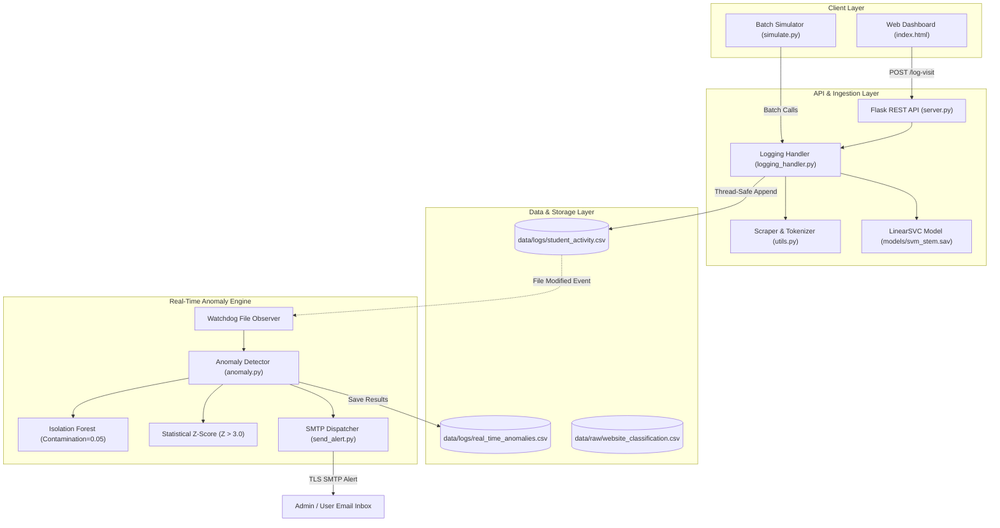

# 🛡️ BYOD Productivity Logger & Real-Time Anomaly Detection System

[](https://www.python.org/)
[](https://flask.palletsprojects.com/)
[](https://scikit-learn.org/)
[](LICENSE)
[]()

A machine learning-powered security and productivity monitoring platform engineered for academic institutions and enterprise **Bring Your Own Device (BYOD)** environments.

The system logs student web browsing sessions, classifies visited websites into **Productive** or **Non-Productive** categories using an NLP pipeline (**TF-IDF + LinearSVC** with **94% accuracy**), monitors time spent against dynamic thresholds, detects behavioral session anomalies via **Isolation Forest** and **Statistical Z-Scores**, and dispatches automated **TLS-encrypted email alerts**.

---

## 📑 Table of Contents

- [Key Features](#-key-features)
- [System Architecture](#-system-architecture)
- [Core Rules & Detection Thresholds](#-core-rules--detection-thresholds)
- [Machine Learning & NLP Pipeline](#-machine-learning--nlp-pipeline)
- [Project Directory Layout](#-project-directory-layout)
- [Getting Started](#-getting-started)
  - [Prerequisites](#prerequisites)
  - [1. Clone & Set Up Virtual Environment](#1-clone--set-up-virtual-environment)
  - [2. Install Dependencies](#2-install-dependencies)
  - [3. Configure Environment Variables](#3-configure-environment-variables)
  - [4. Start the Flask REST API](#4-start-the-flask-rest-api)
  - [5. Start the Anomaly Watcher Observer](#5-start-the-anomaly-watcher-observer)
  - [6. Launch the Web Dashboard](#6-launch-the-web-dashboard)
  - [7. Run Batch Activity Simulation](#7-run-batch-activity-simulation)
- [REST API Reference](#-rest-api-reference)
- [Security & Best Practices](#-security--best-practices)
- [Tech Stack](#-tech-stack)
- [License](#-license)

---

## 🌟 Key Features

- **🌐 Live Web Content Classification**: Dynamically fetches page meta descriptions and titles via `BeautifulSoup` or tokenizes raw domain structures with RegEx to categorize websites across 16 classes.
- **⚡ Real-Time Threshold Alerting**: Immediately flags visits exceeding **300 seconds (5 minutes)** on non-productive domains and calculates excess time overhead.
- **🔍 Dual-Engine Behavioral Anomaly Detection**:
  - **Isolation Forest**: Unsupervised tree ensemble detecting multi-variable session anomalies across visit counts, session durations, and task switches (`contamination=0.05`).
  - **Statistical Z-Score**: Identifies rapid task-switching outliers ($Z > 3.0$).
- **👁️ Event-Driven Watchdog Observer**: Utilizes Python's `watchdog` to monitor session activity logs reactively, eliminating database polling overhead.
- **📧 Automated SMTP Email Dispatcher**: Dispatches encrypted TLS security emails to users and administrators upon anomaly detection, with zero exposed credentials.
- **🔒 Thread-Safe Log Writing**: Uses `threading.Lock()` to prevent race conditions during concurrent API writes to activity logs.
- **🎨 Glassmorphism Web Interface**: Dark-mode user interface built with HTML5, CSS3 design tokens (Outfit typography), and asynchronous JavaScript (`fetch` API).

---

## 🏗️ System Architecture



---

## 📏 Core Rules & Detection Thresholds

| Parameter | Default Value | Config / Source | Description |
| :--- | :--- | :--- | :--- |
| **Alert Time Limit** | `300s` (5 min) | `ALERT_THRESHOLD` / `config.py` | Flags alert (`Alert="YES"`) when time on a **Non-Productive** site exceeds 300 seconds. |
| **Switch Duration Baseline** | `120s` (2 min) | `SWITCH_THRESHOLD` / `config.py` | Baseline metric for task-switching analysis. |
| **Isolation Forest Contamination** | `0.05` (5%) | `IF_CONTAMINATION` / `config.py` | Proportion of expected anomalies in the student browsing cohort. |
| **Z-Score Outlier Cutoff** | $Z > 3.0$ | `Z_SCORE_THRESHOLD` / `config.py` | Flags sessions exceeding 3 standard deviations in category-switching frequency. |
| **Productive Class Set** | `{1, 2, 4, 9, 10}` | `PRODUCTIVE_CATEGORIES` | Classes corresponding to Educational, Business, News, Tech, and Reference domains. |

---

## 📊 Machine Learning & NLP Pipeline

The classification engine maps incoming URLs to topical categories to distinguish productive study materials from distractions:

1. **Text Preprocessing**: Extracts live HTML meta descriptions/titles or tokenizes domain lexical tokens, cleans non-alphanumeric characters, and applies word stemming.
2. **Feature Extraction**: `TfidfVectorizer(ngram_range=(3, 3))` creates character/word n-gram feature vectors.
3. **Classification Algorithm**: `LinearSVC` trained on **1,409 verified web domains** (`data/raw/website_classification.csv`).
4. **Evaluation Metrics**:
   - **Accuracy**: **93.97% (~94%)**
   - **Weighted Precision**: **94%**
   - **Weighted Recall**: **94%**
   - **Weighted F1-Score**: **94%**

Detailed exploratory data analysis, hyperparameter tuning, and cross-validation workflows can be found in [`notebooks/byod_notebook.ipynb`](notebooks/byod_notebook.ipynb).

---

## 📂 Project Directory Layout

```
BYOD/
├── .env.example                 # Template for environment variables & SMTP configuration
├── .gitignore                   # Git ignore patterns for Python, caches, and runtime data
├── LICENSE                      # MIT Open-Source License
├── README.md                    # Project documentation
├── requirements.txt             # Unified Python dependencies
│
├── backend/                     # Python Flask API & Anomaly Detection Services
│   ├── __init__.py              # Package marker
│   ├── config.py                # Centralized configuration, path resolution & env loader
│   ├── server.py                # Flask REST API server (/log-visit, /health)
│   ├── logging_handler.py       # Classification engine & thread-safe CSV logger
│   ├── anomaly.py               # Watchdog observer + Isolation Forest & Z-Score engine
│   ├── send_alert.py            # TLS SMTP email dispatcher
│   ├── utils.py                 # BeautifulSoup meta scraper & lexical URL tokenizer
│   ├── simulate.py              # Batch browsing activity simulation runner
│   ├── main.py                  # CLI simulation entry point (backwards compatible)
│   └── requirements.txt         # Backend dependency list
│
├── frontend/                    # Glassmorphism Client Web Interface
│   ├── index.html               # Responsive HTML5 logging form
│   ├── styles.css               # Modern glassmorphism CSS design system
│   └── app.js                   # Asynchronous fetch client & dynamic UI badge renderer
│
├── data/                        # Structured data repository
│   ├── raw/
│   │   └── website_classification.csv   # Training dataset (1,409 sites across 16 categories)
│   ├── sample/
│   │   └── sample_urls.py       # Sample URL activity records for simulation
│   └── logs/
│       ├── .gitkeep
│       ├── student_activity.csv # Raw browsing activity log
│       └── real_time_anomalies.csv # Detected anomalies output log
│
├── models/                      # Serialized ML Models
│   └── svm_stem(3,3).sav        # Pre-trained LinearSVC + TF-IDF pipeline
│
└── notebooks/                   # Research & Data Science Notebooks
    └── byod_notebook.ipynb      # EDA, model training, evaluation & metrics
```

---

## 🚀 Getting Started

### Prerequisites

- **Python 3.8+** (Python 3.10 or 3.11 recommended)
- **pip** package manager
- Modern web browser (Chrome, Edge, Firefox, Safari)

### 1. Clone & Set Up Virtual Environment

```bash
# Clone repository
git clone https://github.com/your-username/byod-productivity-anomaly-detector.git
cd byod-productivity-anomaly-detector

# Create a virtual environment
python -m venv venv

# Activate virtual environment
# On Windows (PowerShell):
.\venv\Scripts\Activate.ps1
# On Windows (cmd):
.\venv\Scripts\activate.bat
# On Linux / macOS:
source venv/bin/activate
```

### 2. Install Dependencies

Install all required Python packages:

```bash
pip install -r requirements.txt
```

### 3. Configure Environment Variables

Copy `.env.example` to create your local `.env`:

```bash
# On Windows PowerShell
Copy-Item .env.example .env

# On Linux / macOS
cp .env.example .env
```

Edit `.env` to set your custom thresholds and SMTP credentials if email alerting is desired:

```ini
API_HOST=127.0.0.1
API_PORT=5000
ALERT_THRESHOLD=300
SWITCH_THRESHOLD=120
IF_CONTAMINATION=0.05
Z_SCORE_THRESHOLD=3.0

# Optional: SMTP Email Alerts
SMTP_SERVER=smtp.gmail.com
SMTP_PORT=587
SMTP_SENDER_EMAIL=your_security_email@gmail.com
SMTP_APP_PASSWORD=your_16_character_app_password
```

> [!TIP]
> For Gmail, generate an **App Password** via Google Account > Security > 2-Step Verification > App Passwords.

---

### 4. Start the Flask REST API

Run the API server from the project root:

```bash
python backend/server.py
```
*The API server will listen on `http://127.0.0.1:5000`.*

---

### 5. Start the Anomaly Watcher Observer

In a **second terminal window**, activate your virtual environment and start the watchdog service:

```bash
python backend/anomaly.py
```
*The observer watches `data/logs/student_activity.csv` and re-evaluates anomalies in real-time whenever new rows are appended.*

---

### 6. Launch the Web Dashboard

The Flask API server automatically serves the web dashboard! Simply open:
👉 **`http://127.0.0.1:5000/`** in your browser.

Alternatively, you can open `frontend/index.html` directly or serve it via:
```bash
python -m http.server 8000 --directory frontend
```

---

### 7. Run Batch Activity Simulation

To test the entire pipeline with automated mock browsing events, open a third terminal and run:

```bash
python backend/simulate.py
```
Or with custom delay:
```bash
python backend/simulate.py 2.0
```
Watch the anomaly detection terminal react immediately to the newly generated activity logs!

---

## 🚢 Deployment Guide

The project is containerized and ready for cloud deployment via **Docker**, **Render**, or **Railway**.

### Option A: Docker Deployment (Recommended)

Build and run using Docker or Docker Compose:

```bash
# Using Docker Compose (automatically mounts log volume and loads .env)
docker-compose up --build

# Or build and run standalone container
docker build -t byod-platform .
docker run -p 5000:5000 --env-file .env byod-platform
```

Both the **Flask API** and the background **Anomaly Watcher** run concurrently inside the container managed by `start.sh`.

### Option B: Deploy to Render (Free Web Service)

1. Push your repository to GitHub / GitLab.
2. Go to [Render Dashboard](https://dashboard.render.com/) and click **New > Web Service**.
3. Connect your repository.
4. Render will detect the included `Dockerfile` and `render.yaml`.
5. Under **Environment Variables**, add:
   - `SMTP_SENDER_EMAIL` (Optional)
   - `SMTP_APP_PASSWORD` (Optional)
6. Click **Deploy**. Your dashboard and API will be live at `https://<your-app>.onrender.com`.

### Option C: Deploy to Railway

1. Install Railway CLI or go to [Railway.app](https://railway.app/).
2. Click **New Project > Deploy from GitHub repo**.
3. Select this repository. Railway will automatically build the `Dockerfile`.
4. Add environment variables in the Railway dashboard settings.
5. Generate a public domain in Railway network settings.

---

## 🔌 REST API Reference

### Health Check

```http
GET /health
```

#### Response (`200 OK`)
```json
{
  "service": "BYOD Productivity Logger API",
  "status": "online",
  "version": "1.0.0"
}
```

---

### Log Visit

```http
POST /log-visit
Content-Type: application/json
```

#### Request Body
```json
{
  "user_id": 101,
  "url": "https://www.youtube.com/wwe",
  "time_spent": 450,
  "email": "student101@university.edu"
}
```

#### Response (`200 OK`)
```json
{
  "message": "Visit logged successfully!",
  "data": {
    "user_id": 101,
    "url": "https://www.youtube.com/wwe",
    "category": "Non-Productive",
    "time_spent": 450,
    "alert": "YES",
    "excess_time": 150
  }
}
```

#### Error Response (`400 Bad Request`)
```json
{
  "error": "Missing required fields",
  "missing": ["url"]
}
```

#### cURL Example
```bash
curl -X POST http://127.0.0.1:5000/log-visit \
  -H "Content-Type: application/json" \
  -d '{"user_id": 102, "url": "https://www.github.com", "time_spent": 300, "email": "dev@school.edu"}'
```

---

## 🔒 Security & Best Practices

- **Zero Hardcoded Secrets**: Sensitive credentials (passwords, email accounts) have been decoupled from source files into `.env` (safely ignored in `.gitignore`).
- **Input Validation**: API requests strictly enforce typing on `user_id` and `time_spent` to prevent malformed payloads.
- **Race Condition Prevention**: `threading.Lock` protects concurrent file write operations to activity logs.
- **Graceful Fallbacks**: If internet connectivity is interrupted or web scraping fails, lexical fallback tokenization keeps the classification engine functioning.

---

## 🛠️ Tech Stack

- **Backend & APIs**: Python 3, Flask, Flask-CORS, Watchdog, Requests, BeautifulSoup4
- **Machine Learning & Stats**: Scikit-Learn (`LinearSVC`, `TfidfVectorizer`, `IsolationForest`), SciPy (`zscore`), Pandas, NumPy
- **Security & Alerts**: Python `smtplib`, `email.mime` (TLS encrypted)
- **Frontend Dashboard**: HTML5, Vanilla CSS3 (Glassmorphism design system), Vanilla JavaScript (Async `fetch` API)
- **Data & Serialization**: Pickle, CSV

---

## 📝 License

Distributed under the **MIT License**. See [`LICENSE`](LICENSE) for full details.
